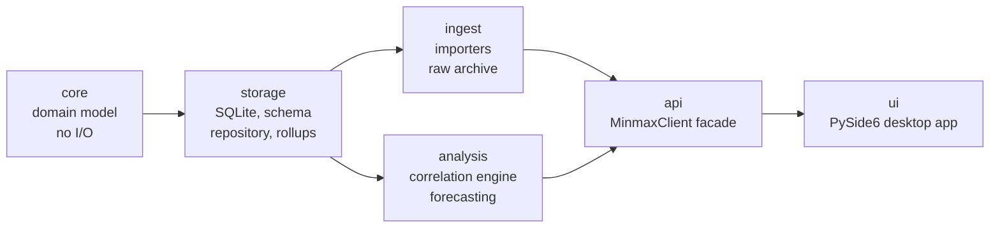

# Minmax — Architecture

This document is the overview of Minmax's code structure: the layers, what lives
in each, the rules about which layer may call which, and how that structure gets
us to the goals in `AGENTS.md` without a rewrite along the way.

It is written to be read by someone picking the project up cold. Where a
decision could reasonably have gone another way, the rationale and the condition
that should make us revisit it are both recorded — see [Key decisions](#key-decisions).

---

## 1. What Minmax is

Minmax is a personal data hub. It imports time-bound data about one person's
life from many sources, stores it durably, lets that person look at it, and —
eventually — tells them which things in their life move together.

Two properties follow from that and drive everything below:

- **The data is precious and largely irreplaceable.** A lost month of
  timetracking cannot be reconstructed. Storage must be transactional, imports
  must be idempotent, and raw source files must be kept.
- **The number of data streams grows without bound, but the *shapes* do not.**
  Timetracking, focused-app history, sleep, heart rate, and commits are five
  sources but only three shapes. Modelling the shapes rather than the sources is
  what keeps the correlation engine from needing a special case per stream.

## 2. Design principles

These are the invariants from `AGENTS.md`, restated as things the code must
structurally enforce rather than merely intend.

1. **The UI cannot reach into the backend.** Not "should not" — *cannot*. The UI
   depends on a single narrow interface (`MinmaxClient`) and never imports a
   storage or analysis module. See [§8](#8-the-ui-boundary).
2. **Dependencies point one direction.** `core → storage → ingest/analysis → api → ui`.
   A module never imports from a layer to its right. This is what makes each
   layer testable alone.
3. **Every write is a transaction.** No partially-applied import is ever visible.
4. **Every import is idempotent and reversible.** Re-importing the same file
   changes nothing; every stored row knows which import produced it, so an
   import can be undone.
5. **Raw sources are immutable.** Imported files are archived byte-for-byte
   before parsing. If the parser was wrong, the fix is to re-import, never to
   hand-edit the database.
6. **Analysis reads aggregates, not raw rows,** wherever it can. This is the
   single decision that keeps the correlation engine fast as streams grow.

## 3. Layer map



Arrows point from a dependency to its dependent: `core` knows about nobody,
`ui` knows only about `api`.

## 4. The domain model

### 4.1 Three stream kinds

Every datastream Minmax will ever ingest reduces to one of three shapes. This is
the central abstraction of the project.

| Kind | Shape | Examples | Rows/year (typical) |
|---|---|---|---|
| **Interval** | something was true from `start` to `end` | timetracking, focused app, sleep phases | 10⁵–10⁶ |
| **Event** | something happened at an instant | git commits, purchases, doses taken | 10³–10⁵ |
| **Sample** | a number had a value at an instant | heart rate, weight, CPU load | 10⁶–10⁸ |

Timetracking — the first stream we implement — is an interval stream. Nothing
about the import, storage, or query path is Timecard-specific; a focused-app
importer written later reuses all of it and differs only in its parser.

Sample streams are the only kind with a scale problem, and they are the reason
rollups ([§7](#7-rollups)) exist.

### 4.2 Categories are hierarchical paths

Interval and event streams label each record with a **category**: `media/gaming/chess`,
`school/exam/CSE 351`. The path is stored whole; the hierarchy is *derived* from
it rather than stored as a parent-pointer tree.

This mirrors Timecard's own design, and earns the same benefits: no migration
when a level is added, no empty-folder edge cases, and roll-up by prefix
(`media/*`) is a string operation. The cost is that renaming a branch re-paths
its descendants — acceptable, and rare.

Categories carry a **stable source id** where the source provides one. Timecard's
`timer_id` survives renames and folder moves, so runs of one timer stay grouped
even though the `timer_name` recorded on each run is only the path *at the moment
it was recorded*. Minmax preserves both: the source id identifies the category,
the recorded path is kept on the record for historical fidelity.

### 4.3 Time is stored twice, deliberately

Every timestamp is persisted as **epoch seconds UTC** *and* the **UTC offset in
effect at that instant**.

UTC alone is not sufficient for a life tracker. Almost every question the user
will ask — "how much did I sleep Tuesday", "what do my mornings look like" — is a
question about *local wall-clock time*. Across a DST boundary or a flight, UTC
silently reassigns records to the wrong local day. Storing the offset alongside
makes the original local time exactly recoverable, and makes "which local day was
this?" a stored fact rather than a guess.

Local date and hour are therefore computed **once at import** and stored, not
recomputed per query.

## 5. Module map

```
src/minmax/
├── core/            # Domain model. Pure. No I/O, no SQL, no framework imports.
│   ├── models.py    #   Stream, Category, IntervalRecord, StreamKind, ImportRun
│   ├── timeref.py   #   Instant, local-period bucketing, offset-aware conversions
│   ├── timeline.py  #   Timeline layout arithmetic over a span (§8) — no Qt
│   ├── trends.py    #   Stacked-area layout arithmetic (§8) — no Qt
│   ├── columns.py   #   Grouping a date range into anchored chart columns (§8.2)
│   ├── measures.py  #   Duration/count/field-aggregate abstraction (§7.1) — no Qt
│   ├── palette.py   #   Validated categorical palette and slot assignment
│   └── paths.py     #   Category path parsing, prefix matching, tree derivation
│
├── storage/         # Persistence. The only layer that knows SQL exists.
│   ├── migrations/  #   NNNN_name.sql, applied in order; the schema's history
│   ├── database.py  #   Connection setup, PRAGMAs, migration runner
│   ├── repository.py#   The read/write API. Callers use this, never raw SQL.
│   └── rollups.py   #   Aggregate maintenance (§7)
│
├── ingest/          # Getting foreign data in. One module per source.
│   ├── base.py      #   Importer protocol, ParseResult, the import pipeline
│   ├── archive.py   #   Byte-for-byte raw file archiving + content hashing
│   ├── rows.py      #   Row-level parsing helpers shared by every CSV importer
│   ├── csvstream.py #   CsvStreamImporter/IntervalCsvImporter -- declared,
│                    #   no-code streams of either kind (§6.1)
│   └── timecard.py  #   Timecard CSV → IntervalRecord (hand-written; the only
│                    #   stream with golden tests against a real export)
│
├── analysis/        # Statistics over stored data. Reads rollups; never writes history.
│   ├── catalog.py   #   Candidate Measures and pairs worth testing (§7.1)
│   ├── series.py    #   Measure -> per-day values, via the repository
│   ├── sweep.py     #   Period bucketing (reuses core/columns.py) and alignment
│   ├── stats.py     #   Pearson's r + Benjamini-Hochberg — the only scipy import
│   ├── correlate.py #   Orchestrates the above into a ranked CorrelationReport
│   └── models.py    #   Correlation/PairResult/CorrelationReport value objects
│                    #   (forecasting is a later goal — see §9)  [not yet built]
│
├── api/             # The facade the UI talks to.
│   ├── client.py    #   MinmaxClient protocol + InProcessClient + transfer objects
│   │                #   (including import_file, which wraps ingest.run_import,
│   │                #   and correlations, which wraps analysis.correlate)
│   └── format.py    #   Formatting every client must render identically
│
├── ui/              # PySide6 desktop app. Imports `api` and nothing else.
│   ├── app.py       #   Event loop entry point
│   ├── main_window.py#  Window, screens, stream picker, navigation,
│                    #   window-loading policy, the one place a
│                    #   dropped/dialog-picked file is handed to import_file,
│                    #   and the once-a-minute auto-fetch timer (§6.2)
│   ├── shortcuts.py #   Every binding, the config file, the conflict rules — no Qt
│   ├── dialogs.py   #   Filter, trends range, column interval, new-stream
│                    #   column-role assignment, shortcut remapping
│   ├── timeline_view.py# Continuous timeline: blocks and point-in-time
│                    #   markers, paint and input, edge loading
│   ├── summary_panel.py# Category totals for the day under the viewport,
│                    #   duration or count depending on the stream's kind
│   ├── record_inspector.py# Full detail and provenance for one record
│   ├── trends_view.py# Stacked area over columns: paint and input only
│   ├── trends_legend.py# Per-group share of the visible columns
│   ├── correlations_view.py# The correlation sweep's results table -- a
│                    #   native QTableWidget, nothing custom-painted (§7.1)
│   └── theme.py     #   Colours derived from the system palette (light/dark)
│
└── cli.py           # Command-line entry point. A thin shell over the layers
                     # above, and how the data is reachable without a GUI.
```

Each layer's hard rule:

- **`core`** may not import anything from Minmax outside `core`, and may not
  perform I/O. Everything here is deterministic and trivially unit-testable.
- **`storage`** is the sole owner of SQL. If a string containing `SELECT` appears
  outside `storage/`, that is a bug.
- **`ingest`** parses and validates; it does not decide storage layout. An
  importer's job is to turn a foreign file into validated `core` objects and hand
  them to the repository in one transaction.
- **`analysis`** is read-only with respect to user data. It may write to caches
  and derived tables, never to the record of what happened.
- **`api`** contains no business logic — it composes the layers below into the
  operations a UI actually needs, and is the *only* thing the UI may import.
- **`ui`** contains no logic worth testing headlessly. If something in `ui` needs
  a unit test, it belongs one layer down.

## 6. Storage

**SQLite**, one file, as the store of record.

The schema is organised around the three stream kinds:

- `stream` — one row per datastream (`timecard`, `focused_app`), carrying its
  kind, whether it is *exclusive* (at most one observation true at a time),
  and, since migration `0005`, the path and on/off flag behind auto-fetch
  ([§6.2](#62-auto-fetch-a-remembered-path-re-imported-on-a-timer)).
- `category` — categories within a stream, keyed by stable source id, holding the
  current path.
- `interval_record` — interval observations, indexed on `(stream_id, started_at)`.
- `event_record` / `event_value` — point-in-time observations and their
  payload, added in migration `0004` when the first such stream landed. See
  [§6.1](#61-point-in-time-streams-an-eav-schema).
- `stream_field` — the column-role mapping a user declares once for a
  point-in-time stream, reused for every later import into it.
- `import_run` — provenance: which file (by SHA-256), when, how many rows
  inserted/skipped. Every observation row carries its `import_run_id`, which is
  what makes an import reversible.
- `rollup` / `field_rollup` — derived aggregates, keyed by `(stream, category,
  period, bucket)` and, for numeric fields, additionally by field
  ([§7](#7-rollups)).

Migrations live in `storage/migrations/` as numbered SQL files and are tracked
by SQLite's own `user_version`, so a fresh database needs no bootstrapping and
each migration applies atomically or not at all.

**Idempotency** is enforced by the database, not by the importer: a uniqueness
constraint on each observation's natural key (`stream_id`, `category_id`,
`started_at`, `ended_at`) means a re-import inserts nothing. The importer reports
what was skipped rather than discovering duplicates itself.

**Everything goes through `repository.py`.** That indirection is not ceremony —
it is the seam that lets the analytics engine change later ([§10](#key-decisions))
without touching a single caller.

### 6.1 Point-in-time streams: an EAV schema

An interval stream's payload is fixed — a category and a span — so one table
with fixed columns fits every source. A point-in-time stream's payload does
not: a phone-pickup log carries nothing beyond the instant, a heart-rate
stream carries one number, a location stream carries two numbers and a label.
Fixing the column set to any one of those would make the others a bad fit, and
a stream cannot be picked in advance for a user who has not created it yet.

The schema handles this as entity-attribute-value rather than as a JSON
payload column:

```
stream_field(stream_id, key, label, role, unit, position, source_column)
event_record(id, stream_id, category_id, import_run_id, occurred_at, offset_seconds, payload_hash)
event_value(record_id, field_id, num, txt)   -- CHECK ((num IS NULL) <> (txt IS NULL))
```

`stream_field` is the mapping a user declares once, in the GUI's new-stream
dialog, by pointing at the CSV's actual header — which column is the category,
which (if any) is a stable source id, which are values, and which is the
timestamp. It is stored and reused for every later import into that stream, so
the mapping is asked once, not per file.

**Why EAV and not a JSON column:** the whole storage layer's posture is that
the database rejects malformed data rather than trusting the producer
([§2](#2-design-principles), point 3) — a JSON blob cannot participate in that,
since a corrupt or wrongly-shaped value has nowhere to fail loudly, and
aggregating inside one (`AVG(json_extract(...))`) is a full scan with no index
to use. `event_value`'s `CHECK` makes "exactly one of a number or text" a
property the database enforces, not a convention parsers are trusted to
follow. The row multiplication (one to three value rows per event) costs
nothing at the scale event streams actually run at (10³–10⁵ rows/year,
[§4.1](#41-three-stream-kinds)).

**A stream declaring no category column** files every record under one
implicit category whose path is the stream's own key, created lazily the
first time it is seen. A sentinel path like `(all)` would need excluding from
the filter dialog, the drill-down stack, and the palette; the stream key needs
excluding from nothing, because it is already how the stream is addressed
everywhere else.

**The natural key is `(stream, category, occurred_at, payload_hash)`**, not
just `(stream, category, occurred_at)`. Two distinct readings at the same
instant — two GPS fixes a millisecond apart, truncated to the same second —
must both survive; hashing the row's own field values (not the timestamp)
lets that happen while re-importing the same file is still a no-op. The named
limitation this leaves: a stream with *no* declared fields has a constant
hash, so two field-less events landing in the same second collapse into one.
The fix, if it is ever needed, is to declare a field that distinguishes them —
not a schema change.

**`stream_field` also carries a declared interval stream's column mapping**
(`START`/`END`/`CATEGORY`/`SOURCE_ID`/`IGNORED` roles, migration `0006`), not
only an event stream's. This does not reopen the EAV-vs-fixed-columns choice
above — it is the opposite case, restated: an interval's payload *is*
fixed-shape (a category and a span), so `interval_record` keeps its own fixed
columns and gained no `event_value`-style table. `stream_field` was already
structurally kind-agnostic (`create_stream`/`stream_fields` never branched on
kind); only its role vocabulary was event-only. A declared interval stream
therefore cannot carry `NUMBER`/`TEXT` columns — there is nowhere to store
them, and an importer rejects a declaration that tries (`ingest.csvstream.
validate_declaration`). An interval CSV's extra columns (Timecard's own
`duration_seconds`, say) are declared `IGNORED` rather than mapped anywhere.

### 6.2 Auto-fetch: a remembered path, re-imported on a timer

A stream can opt in to being re-imported from a filesystem path once a
minute, so a live feed (a phone's location log, appended to continuously)
stays current without a manual re-import each time. It is deliberately built
from parts that already existed rather than as a new pipeline:

- `stream.watch_path` / `stream.watch_enabled` (`storage/repository.py`'s
  `set_stream_watch`) are the only new state. Everything else — archiving,
  hashing, parsing, the natural-key merge — is the same `run_import` an
  interactive import goes through, called again by `MainWindow`'s `QTimer`
  instead of by a file dialog.
- **Re-importing a growing file is a merge, not a duplication**, for the same
  reason a re-import already was: the natural-key constraint on
  `interval_record` / `event_record` recognises rows it has already stored, so
  reading the whole file fresh each minute only ever inserts what is new.
  Nothing incremental needed building.
- **Backing up is a side effect of the existing archive step**, not new
  behaviour either: `run_import` hashes before archiving and skips the archive
  entirely when the content matches the last import, so an unattended feed
  that has not grown since the last tick costs one query, not one more
  archived copy — see [§6](#6-storage)'s idempotency paragraph.
- **Opt-in per stream, not automatic for every one that has ever been
  imported into.** Two reasons: not every source is a live feed worth polling
  every minute, and there would be nothing to resume from for most existing
  streams regardless — `import_run.source_name` has only ever stored a
  filename, never the full original path, so `watch_path` only starts
  existing once a stream is (re-)pointed at a file after this feature.
- **A failure — the file has moved, or the merge itself raises
  (`OverlapError`, or a column-shape mismatch) — prompts for a replacement
  path exactly once, then pauses that stream's auto-fetch if the reader
  cancels**, rather than either popping a file picker every minute
  indefinitely or silently giving up. `MainWindow._auto_fetch_one` is the one
  place that decides this; `_run_auto_fetch` (the timer's target) also skips
  the whole tick while a modal dialog is already open, so a background fetch
  can never interrupt a reader mid-dialog with a second one.
- This is a GUI concern, not a CLI or storage one: nothing under
  `storage/` or `ingest/` knows auto-fetch exists, and the CLI has no
  equivalent command today (a deliberate scope cut — see `TODO.md`).

## 7. Rollups

The correlation engine asks questions like "minutes of `media/*` per day" and
"mean heart rate per hour" ([§7.1](#71-the-correlation-engine-measures-and-a-period-sweep)).
Answering those from raw rows means scanning everything, every time;
answering them from precomputed aggregates is a bounded-size lookup.

So aggregates are a first-class stored table, refreshed transactionally as part
of each import:

```
rollup(stream_id, category_id, period, bucket, seconds, record_count)
```

`period` is `hour` or `day`; `bucket` is `YYYY-MM-DDTHH` or `YYYY-MM-DD`. Those
key formats sort lexicographically in chronological order, so a range query over
rollups is a plain string comparison.

Bucketing is by **local** hour/day, per [§4.3](#43-time-is-stored-twice-deliberately),
and an observation crossing a bucket boundary is *split* across the buckets it
touches while remaining one row — 29 of the 338 runs in the first Timecard
export cross local midnight, so without splitting, daily totals would be badly
wrong. `record_count` counts observations touching a bucket, which makes it
meaningful within a bucket but not summable across them.

Three years across twenty streams is on the order of 10⁵ rollup rows — small
enough to scan exhaustively no matter how large the raw tables get. This is why
SQLite remains appropriate even once sample streams arrive: analysis rarely
touches the expensive tables.

Maintenance has two paths on purpose. `apply_intervals` folds newly inserted
rows in incrementally, at a cost proportional to the insert rather than the table
size. `rebuild` recomputes from the observation tables, and is both the repair
path after a revert and the oracle the incremental path is tested against — a
test asserts the two agree, so aggregate drift cannot go unnoticed. `rebuild`
dispatches per stream by kind, so it is not just intervals that get repaired.

**A point-in-time stream reuses `rollup` for "how many," and needs a second
table for its numeric fields.** `apply_events` upserts `seconds = 0,
record_count = 1` per event into the same `rollup` table `apply_intervals`
already writes to — an event stream's `record_count` is unlike an interval
stream's in one respect worth flagging wherever it is touched: it is summable
*across* buckets (ten pickups today plus ten yesterday is twenty), where an
interval stream's is only meaningful *within* one, since one long run touches
several buckets without becoming several observations. A numeric field (heart
rate, a GPS coordinate) does not fit `rollup`'s columns at all — there is
nothing to key a specific field on — so it gets its own table,
`field_rollup(stream_id, category_id, field_id, period, bucket, sum, count,
min, max)`. A **mean is never stored**, only derived as `sum / count` at read
time: storing it would make a multi-day column's mean the mean of daily means
rather than the correct value-weighted one, silently wrong the moment two days
have different counts.

### 7.1 The correlation engine: measures and a period sweep

`analysis/` answers "when X increases in a period, does Y tend to also
increase" — swept over many period lengths (a day, a week, a month, ...)
rather than one fixed one, since the interesting period for any given pair of
streams is not known in advance.

**A `Measure`** (`core/measures.py`) is what gets compared: a stream's
duration or event count (from `rollup`), or a declared numeric field's
sum/mean/min/max (from `field_rollup`). This is the abstraction decision
**D6** sketched and deliberately left unbuilt — see D6 and **D7** below for
why now was the right time and what was actually built, which differs from
what D6 sketched in one respect worth knowing up front: `field_rollup` had
never had a reader anywhere in the codebase until this closed that gap
(`Repository.daily_field_totals_by_category`).

**Alignment reuses `core/columns.py`'s anchoring, unchanged.** Two series
bucketed independently at the same `Interval` land on identical period
boundaries (the anchor is a fixed epoch, not either series' own range), so
pairing them is a plain key intersection, not a calendar computation —
[§8.2](#82-columns-and-why-they-are-plotted-as-averages) already relies on
the same guarantee for the trends chart, and the correlation engine is simply
a second, more demanding consumer of it.

**A period is only used if it is complete and the stream was not in a total
blackout.** A partial period at the edge of a series' data (`Column.clipped`)
is dropped rather than rescaled, since rescaling is only valid for a sum, not
for a mean or an extreme. A period where a stream recorded nothing at all is
treated as *missing*, not zero — deliberately different from how the trends
chart treats the identical gap (it draws an honest zero, since compressing a
tracking gap away would misrepresent "I stopped tracking" as "these days were
adjacent"). A correlation has a failure mode the chart does not: two
unrelated streams that both happened to be switched off at once would
otherwise look like they moved together, when neither was actually observed.

**Every (pair, period-length) test performed feeds one Benjamini-Hochberg
correction** (`analysis/stats.py`), computed over the whole sweep before
anything is filtered for display, and reported as a q-value rather than
enforced as a hard cutoff — this is hypothesis generation for one person
deciding what to try next month, not a publication, and a strict cutoff would
return an empty table against the amount of data Minmax has today. A pair's
*stability* across the sweep (does the relationship hold at several period
lengths, or only the one the sweep happened to find) is treated as the more
trustworthy signal.

Reachable two ways: `minmax correlate` on the command line, and a third
desktop screen (`ui/correlations_view.py`'s `CorrelationsTable`, wired up by
`main_window.py`'s `CorrelationsScreen`) reachable with `3`. Both call the
same `MinmaxClient.correlations()` and render the same
`CorrelationRow`/`CorrelationsView` transfer objects — nothing analysis- or
statistics-specific lives in `ui/`. The screen is deliberately **not** scoped
to one stream the way `DayScreen`/`TrendsScreen` are (the whole point of the
engine is comparing *across* streams), so it does not participate in
`MainWindow.set_stream()`/the stream picker, and its sweep is not run until
the screen is actually shown for the first time, or data changes while it is
already the visible one — recomputing a cross-stream sweep on every launch or
stream switch would be wasted work most of the time. Neither surface touched
`api/client.trends()` or the rest of `ui/` at the time (see **D7**) — that
stopped being true once the trends chart itself gained a field-metric
selector (**D8**).

## 8. The UI boundary

`AGENTS.md` requires that redoing the UI have no effect on the underlying
systems. That is enforced by construction:

```
ui  ──▶  MinmaxClient (protocol)  ──▶  { InProcessClient | HttpClient }
```

The UI is written against the `MinmaxClient` **protocol** only. Today the desktop
app binds it to `InProcessClient`, which calls the repository and analysis layers
directly — no server process, no serialization cost. When the web UI arrives, an
`HttpClient` implementation and a thin server that exposes the same operations get
added; neither the existing UI nor any backend module changes.

The protocol is therefore designed as though it were already a network API:
coarse-grained operations, serializable arguments and return values, no leaking
of live database objects across it. A test walks `ui/` and fails if any module
there mentions `storage`, `ingest`, or `analysis`, so the boundary is checked
mechanically rather than by discipline. Importing a file from the desktop app
(a file dialog, or a drop onto the window) is not an exception: `ui/` hands the
path to `MinmaxClient.import_file()`, and it is `InProcessClient` — in `api`,
not `ui` — that calls `ingest.run_import`. A future `HttpClient` implements the
same method as an upload request; the UI's code does not change.

**Anything the UI would otherwise have to compute lives below it.** Three kinds
of thing get pushed down, each for the same reason — a second client must not be
able to disagree with the first, and logic hidden in a paint method is untested
logic:

- *Layout arithmetic* → `core/timeline.py`. Block positions, label thresholds,
  and the scroll offset that keeps zoom anchored under the pointer. Free of Qt,
  and unit-tested directly.
- *Calendar grouping* → `core/columns.py`. Which days a chart column covers, for
  any interval from one day to a year. Anchored to the calendar rather than
  chopped from the range's first day, so the same Tuesday always lands in the
  same column; clipped rather than reaching outside the range, so a column never
  reports days that were not asked for.
- *Timezone-dependent labels* → `api`. Turning an hour boundary into a clock
  reading needs a timezone, so a view carries labelled `hour_marks` and
  `day_marks`. A view deriving labels from elapsed time would count to `24:00`
  on a fall-back day when the clock actually read `01:00` twice. Column labels
  (`5 Jun`, `June 2026`) are attached here for the same reason.
- *Provenance* → `api`. Each `TimelineRecord` carries the id and filename of the
  import that produced it, resolved when the records are fetched rather than
  when one is clicked, so inspecting a block is not a second round trip.
- *Colours* → `core/palette.py` plus the `group_color` table. Timecard gives
  colour to a top-level folder so a whole branch reads as one colour, and Minmax
  keeps that model. Colours are *assigned from the palette and stored*, not
  hashed from the name: hashing is stable but collides, and a sorted index would
  shift a group's colour the moment another group appeared. What is stored is a
  palette **slot**, not a hex value, so each slot carries its own step for light
  and dark surfaces and the palette can be re-stepped without a migration.

### 8.1 Chart rules

The trends chart follows a fixed set of rules rather than taste, because a chart
is read by people and a plausible-looking wrong one is worse than none:

- **At most eight categorical hues**, in a fixed assignment order, never cycled.
  Past eight, adjacent hues stop being distinguishable under colour-vision
  deficiency, so the tail folds into a neutral `Other` — which is not given a hue,
  because it is not an identity.
- **Colour follows the entity, never its rank.** The series set and its colours
  are decided over the whole range, not the visible window, so scrolling never
  repaints anything.
- **The palette is validated, not eyeballed.** The eight steps clear the
  lightness band, chroma floor, CVD separation (worst adjacent ΔE 9.1 light /
  8.4 dark against a target of 8) and the normal-vision floor (19.6 / 19.3
  against 15) on both surfaces. Three light steps fall below 3:1 contrast, which
  obliges visible labels — the legend supplies them.
- **A legend is always present**, so identity is never carried by colour alone,
  and no value is printed on every point: the axis and the hover tooltip carry
  detail.
- **Solid hairline gridlines**, never dashed (dashing reads as a threshold), and
  a 2px surface gap between stacked bands rather than borders around them.
- **Empty periods are drawn as empty.** A period with no data keeps its column,
  and in percentage mode it stays at zero rather than being stretched to fill —
  an untracked day has no composition to show.

### 8.2 Columns, and why they are plotted as averages

The trends chart is indexed by *column*, never by day. A column covers an
`Interval` — a unit (day, week, or month) and a count, so a fortnight and a
quarter are as sayable as a week (`core/columns.py`). The pixel arithmetic in
`core/trends.py` does not know how much time a column holds, which is what makes
aggregation a data change rather than a rendering change.

**Multi-unit intervals are anchored to a fixed epoch**, for the same reason
single ones are aligned to the calendar. A fortnight column that started
wherever the range started would be a different fortnight every time the range
moved, and two charts of the same interval could not be compared. Counting from
an epoch makes the grouping a property of the calendar rather than of the query:
`Interval(MONTH, 3)` is always calendar quarters, `Interval(MONTH, 12)` always
calendar years, and — because the epoch is a Monday — `Interval(DAY, 7)` lands
exactly where `Interval(WEEK)` does rather than a day off it.

The count is capped (`MAX_INTERVAL_COUNT`) so a slipped keystroke cannot ask for
a column measured in centuries, and `AUTO` cannot carry a count, because it picks
its own unit and would have nothing to multiply.

**A column is plotted as its daily average, not its total.** A weekly column
holds roughly seven times the seconds of a daily one, so plotting totals would
rescale the y axis by seven the moment the granularity changed, and the same
data would appear to describe a different life. Dividing by the days a column
covers keeps the axis in hours-per-day at every granularity, and the axis
ceiling — capped at 24h, since a day cannot hold more — keeps meaning the same
thing. It also removes a second problem for free: a half-week at the edge of a
range would otherwise read as a collapse in activity rather than as a shorter
column.

Totals are still what the legend and the tooltip report, because "how much" is
the question those answer. Only the plotted height is an average.

**Granularity is chosen automatically by default.** A reader opening ten years
of history should not have to discover that monthly columns exist before the
chart becomes legible, so `Granularity.AUTO` resolves against the span. The
resolved value is always reported back, and the screen names it in the title —
under AUTO especially, since the reader did not choose it.

**"Fit all" is not subject to the zoom ceiling.** `MAX_PIXELS_PER_COLUMN` bounds
manual zoom so that holding `+` cannot leave one column filling the screen with
nothing to compare it to. But a quarterly interval over a year is four columns
and a yearly one can be a single column; any ceiling low enough to keep manual
zoom sensible would strand those against the left edge with the rest of the plot
blank, which reads as missing data. `fit_column_zoom` is therefore floored but
not capped — "fit" means fit.

### 8.3 The timeline is a window, not a day

The day timeline scrolls continuously through midnight, so its unit is a run of
consecutive days rather than a single one. `MinmaxClient.window()` returns that
run — records, hour marks, day marks, and per-day totals in one call — and the
pane extends it as the reader approaches either end, anchoring the scroll
position on an instant so that growing the window is invisible.

Three consequences worth knowing:

- **A midnight-crossing run is one record with no seam.** The clipping and
  continuation flags in `lay_out_blocks` now fire only at the window's outer
  edges, where they honestly mean "there is more of this than has been loaded".
- **Per-day totals travel with the records**, so scrolling from one day to the
  next repaints the totals panel without a second round trip.
- **The window is capped** (`MAX_WINDOW_DAYS`), and extension is bounded by the
  recorded range. Scrolling into a decade of empty days is not navigation.
  Explicit navigation — "go to date" — is deliberately *not* bounded by it, and
  widens the limits so the reader can scroll back from wherever they landed.

**A point-in-time record shares the same window and the same `lay_out_blocks`
call**, not a parallel code path. `start_epoch == end_epoch` (see
`TimelineRecord.is_instant`, [§6.1](#61-point-in-time-streams-an-eav-schema))
lays out as a fixed-height marker centered on the instant instead of a
duration-sized block, but it is still one entry in the same list, clipped to
the same window, hit-tested by the same rect. Half-open containment needed its
own branch for the zero-width case — the span-overlap check that correctly
excludes a run ending exactly at a window's start would also (incorrectly)
exclude a point landing exactly there.

## 9. Roadmap → structure

How each goal in `AGENTS.md` lands in the structure above.

| Goal | Where it lives | Needs new structure? |
|---|---|---|
| Import/store/retrieve timetracking ✅ | `ingest/timecard.py`, `storage/` | — |
| UI for timetracking ✅ | `ui/`, `api/client.py` | — |
| Trends over time ✅ | `ui/trends_view.py`, `core/trends.py`, `core/columns.py` | reads `rollup` (day), or `field_rollup` for a declared numeric field's total/average (§7.1, D8); every interval from a fortnight to a year is summed from it, so no second rollup period is needed |
| Correlation engine ✅ (level correlations, CLI + desktop screen) | `analysis/`, `minmax correlate`, `ui/correlations_view.py` | reads `rollup`/`field_rollup` (day), via `core/measures.py` (§7.1) |
| Streams beyond timetracking ✅ (event and interval, both no-code) | `ingest/csvstream.py`, `storage/` (§6.1) | a declared stream of either kind is user-declared, not a new module per source -- see D5 |
| Multi-stream timeline | `ui/`, one new `api` query | still one stream on screen at a time -- the picker switches between streams, not several overlaid |
| Cross-stream correlation ✅ | `analysis/catalog.py` | came for free: a `Measure` doesn't know or care which stream it reads from |
| Recommendations / "Increase X" → advice queries | `analysis/` | ranks existing correlations; needs a query interface on top, not a new engine |
| DL forecasting model | `analysis/` submodule | training data comes from rollups |

Every later goal is additive. Nothing above requires the storage schema or the
layer boundaries to change — which was the point of settling them now.

## 10. Testing strategy

Per the invariants, tests exist to protect the data and the experience:

- **`core`** — pure unit tests. Path parsing, DST-boundary local-day bucketing,
  time range arithmetic.
- **`storage`** — round-trip tests against a temp-file database, plus explicit
  tests that constraints *reject* bad data (overlapping intervals, duplicate
  natural keys, orphaned categories).
- **`ingest`** — golden-file tests against a real Timecard export, malformed-input
  tests (bad timestamps, unclosed quotes, negative durations), and an
  **idempotency test**: importing twice must leave the database byte-identical.
- **`analysis`** — statistical results checked against hand-computed fixtures.
- **`api`** — the facade tested through its protocol, which doubles as the
  contract the future `HttpClient` must satisfy.
- **`ui`** — only wiring, run headless on Qt's offscreen platform: that the
  window asks for the right days, that scrolling loads more of them, that every
  binding names a method that exists, and that no module in `ui/` mentions a
  backend package. The two pieces of `ui/` with rules rather than pixels —
  `shortcuts.py` and the layout arithmetic — are tested without Qt at all.

Time is injected, never read from the system clock inside logic, so every
time-dependent rule is deterministic.

---

## Key decisions

Recorded with rationale and the condition that should trigger a revisit.
All four were reviewed with the user on 2026-08-05.

### D1 — Python

The endpoint goals are a correlation engine and a custom DL model; that work
lives in Python's ecosystem (polars, scipy, statsmodels, PyTorch). Type hints
plus a type checker give enough static safety for a data-integrity-critical
codebase.

*Rejected:* TypeScript (would need a Python service for analysis anyway,
splitting the codebase); Rust (slow to reach the analysis goals, and single-user
data volumes never need its speed); Swift (matches Timecard, but has no analysis
or DL ecosystem).

*Revisit if:* an import path becomes CPU-bound in a way vectorization can't fix.

### D2 — SQLite as store of record

Single file, ACID, zero operational burden, backed up by copying one file. Holds
up well past the scale a personal hub reaches: ~100M narrow rows is 5–10 GB with
indexed time-range reads still fast.

The known weakness is full-table analytical scans over sample streams, since a
row store reads every column. That is mitigated structurally by rollups
([§7](#7-rollups)), which keep analysis off the raw tables entirely.

*Rejected:* DuckDB as primary (weaker as a concurrently-written store of record);
Parquet/flat files (no transactions or constraints — directly conflicts with the
data-safety invariant); PostgreSQL/TimescaleDB (a server to run and back up for
one user, with no payoff at this size).

*Revisit if:* a single stream passes ~50M raw rows **and** a query can't be
served by a rollup. The escape hatch is additive, not a rewrite — DuckDB reads
SQLite files and Parquet directly, so it can be attached as a read-only analytics
engine behind `repository.py`, and cold sample data can age out to Parquet on the
same path.

### D3 — PySide6/Qt native desktop UI

Keyboard-first interaction is a priority, and Qt's `QAction`/`QShortcut` model
gives fully remappable, discoverable shortcuts. Keeps the project to one
language, and Qt's painting is well suited to the zoomable timeline goal.

*Rejected:* SwiftUI (truly native and consistent with Timecard, but a second
toolchain and a forced HTTP boundary from day one); Textual (excellent
keyboard story, weakest fit for the dense timeline).

*As built:* the timeline is a custom-painted `QWidget` inside a `QScrollArea`
rather than a `QGraphicsView`. Even scrolling continuously across days it stays
a single column of non-overlapping blocks, which needs neither a scene graph nor
item picking, and direct painting keeps the widget to paint-and-input with all
arithmetic in `core/timeline.py`. The bounded window (§8.3) is what keeps that
true: cost is proportional to what is loaded, not to history. The trends chart
goes further and paints only the visible column range rather than living in a
scroll area at all — ten years at maximum zoom would otherwise be a
290,000px-wide widget.

`QGraphicsView` remains the natural choice for the multi-stream timeline, where
many lanes and per-item interaction do earn a scene.

The remappable-shortcut promise is delivered in `ui/shortcuts.py`, which is
deliberately Qt-free: the actions, the editing dialog, and the config file are
built from one table, and the rules about what a valid binding is are testable
without a display.

*Revisit if:* the multi-stream timeline arrives, or rendering stops being smooth
at maximum zoom.

### D4 — Facade now, HTTP later

The UI binds to the `MinmaxClient` protocol; the native app uses the in-process
implementation. A web UI later adds an `HttpClient` and a server behind the same
protocol.

*Rejected:* HTTP from day one (a server process and serialization cost for a
separation the protocol already guarantees); direct in-process calls (nothing
would structurally stop UI code from depending on backend internals — the one
invariant `AGENTS.md` is most explicit about).

*Revisit if:* a second client appears — at that point the `HttpClient` gets
written, which is the planned path rather than a change of course.

### D5 — EAV over a JSON payload for point-in-time streams

A user-defined stream's payload shape cannot be known in advance — nothing,
one number, several numbers, or text, per [§6.1](#61-point-in-time-streams-an-eav-schema).
`event_value(record_id, field_id, num, txt)` with a `CHECK` keeps the database
able to reject a malformed value the way it already rejects a bad interval;
a JSON column would move that responsibility onto every reader instead, with
no index able to help an aggregate query.

*Rejected:* a JSON payload column (no constraint, no indexed aggregation —
directly conflicts with the "the database rejects bad data" posture the rest
of the schema follows); one fixed wide table with `value1..valueN` columns
(caps the payload shape at N and wastes space on every stream using fewer).

*Revisit if:* a stream needs a payload shape EAV cannot express cleanly —
nested or repeating structure, for instance — at which point a per-stream
typed table (closer to `interval_record`'s fixed-columns approach) is likely
worth the migration.

### D6 — Reuse the seconds-shaped trends machinery for counts; no `Measure` type yet

Once a point-in-time stream exists, the trends chart needs to plot something
other than seconds. The design originally drafted here was a full `(stream,
measure)` pair — duration, count, or a numeric field aggregated by sum, mean,
min, or max, with a `Measure.extensive` property deciding whether categories
could be stacked and whether a column divided by the days it covers. That
was not built. What shipped instead is narrower: an event stream's "how
much" is its **count**, and a count is extensive in exactly the way a
duration is — it sums over disjoint sets, stacks the same way, and a
multi-day column's daily average means the same thing. So every trends field
that held seconds (`TrendsView.total_seconds`, `TrendSeries.values`,
`DayView.tracked_seconds`, …) now dual-purposes as a count when
`stream_kind` is `EVENT`, and exactly one function, `api.format.format_measure`,
decides how a total reads — a duration or "N events" — everywhere a total is
shown. No second chart mode, no stacking decision, because a count never
raises the question a mean would.

The one place that could not be reused as-is: `core/trends.nice_seconds_ceiling`
intentionally tops out at 24h, since a duration's daily average cannot exceed
a day's hours. A count has no such ceiling, so it gets its own
`nice_count_ceiling` with the same "round to a readable step" shape but no
artificial cap.

*Rejected:* the full `Measure` abstraction described above, before anything
needed it — `field_rollup` ([§6.1](#61-point-in-time-streams-an-eav-schema))
already stores what a numeric field's sum/mean/min/max would read from,
untouched by this decision, so building the abstraction now would mean
guessing at a shape for a chart mode (an unstacked line, since a mean cannot
stack) that has no caller yet.

*Revisit if:* a numeric field's own aggregate (mean heart rate per day, not
just how many readings) needs to reach the chart. At that point the count
reuse stops working — a mean genuinely cannot stack — and the `Measure`
abstraction sketched above (or something like it) becomes worth building
against a real second caller instead of a guessed one. The one-axis rule
([§8.1](#81-chart-rules)) still applies regardless: two measures of different
units is small multiples or an indexed comparison, never a second axis.

### D7 — The `Measure` abstraction, built for the correlation engine

D6's stated trigger was a numeric field's own aggregate reaching *the trends
chart*. That had not happened yet at the time of this decision — see **D8**
for when it did — `api/client.trends()` and everything under `ui/` were
unchanged by this one. What actually fired first is the same
underlying condition D6 named (a numeric field's mean/sum/min/max needing to
reach a real consumer, not a guessed one): the correlation engine
([§7.1](#71-the-correlation-engine-measures-and-a-period-sweep)) needs to
compare a duration, an event count, and a heart-rate mean side by side, which
is exactly the shape D6 declined to guess at. `core/measures.py`'s `Measure`
is close to what D6 sketched — `MeasureKind` (duration/count/field) plus
`Aggregate` (sum/mean/min/max), with `summable_across_periods` standing in
for the sketched `Measure.extensive` — built against this real caller instead.

Two things worth naming precisely, since a future reader comparing this to D6
could otherwise conclude more was unified than actually was:

- **`Repository.daily_field_totals_by_category` is new.** `field_rollup` had
  been write-only since migration `0004` — nothing anywhere in the codebase
  had ever read it before this. Closing that gap was the first step of this
  work and is useful on its own, independent of everything after it.
- **The trends chart's count-reuse hack (D6) is untouched.** `Measure` was
  deliberately not retrofitted onto `TrendSeries`/`TrendColumn` in this pass
  — that would be a UI-facing refactor in front of an unproven engine, and
  the existing reuse is still correct for what the chart does today.
  `summable_across_periods` is shaped so the chart *could* adopt it later
  (it is exactly the question a mean-valued axis would need answered before
  plotting a daily average), but nothing forces that now.

*Rejected:* generalising `Measure` to also describe text-field aggregates
(mode, distinct count) — no caller needs one yet, and the two-value shape
(`num`/`txt`, mutually exclusive) `event_value` already enforces would need
its own reduction rules that would be guessed at, the exact mistake D6 was
about not repeating.

*Revisited in* **D8**, where the trends chart gained exactly this: a numeric
field's own total and average, not just an event count.

### D8 — The trends chart's metric selector: `Aggregate` reused, `Measure`/`SeriesLoader` not

D7 predicted correctly what would trigger this: the trends chart needing to
plot a declared numeric field's own total or average, not just an event
count. `TrendsScreen` now offers a dropdown — Count, `<field>` total,
`<field>` average — backed by `MinmaxClient.trends(field_key=...,
aggregate=...)` and a new `TrendMetric` transfer object (`api/client.py`)
carrying the chosen metric's label, unit, field key, aggregate, and whether
it stacks.

**What was reused from D7's `Measure` work:** `core.measures.Aggregate`
(`SUM`/`MEAN`), and the invariant it exists to enforce — a multi-day mean is
`Σvalue_sum / Σvalue_count` over the days it covers, never the mean of the
days' own means. `TrendSeries` grew a `weights` field for exactly this,
alongside `values`; the two are divided only once, at the last moment before
display, the same rule `Measure.reduce` and `DailyValue.weight` already
encode for the correlation engine.

**What was not reused: `Measure`/`DailyValue`/`SeriesLoader` themselves.**
That machinery is shaped for the correlation engine's problem — many streams,
each read once and cached per *day*, aligned across an arbitrary sweep of
period lengths chosen after the fact. The trends chart's problem is
different: one stream, already grouped into calendar *columns*
(`core/trends.py`'s existing day/week/month/custom-count machinery), needing
per-column values *and* weights per category so that ranking, the
`max_series` cap, and the "Other" fold all keep working the way they already
did for a count or a duration. Threading `SeriesLoader`'s per-day cache
through `columns_for`'s grouping would mean deriving column boundaries a
second way; reading `Repository.daily_field_totals_by_category` straight into
the same `column_of` lookup `trends()` already builds for `rollup` rows was
more direct.

**An average cannot stack, so it does not try to.** `TrendMetric.stacks` is
false for `Aggregate.MEAN`, and `TrendsChart` grows a second, parallel paint
path (`_line_values`/`_paint_lines`) alongside the existing stacked-band one,
rather than forcing both shapes into one code path. A category with no
reading in a column plots as a gap (`None`), not a false zero — the same
honesty [§8.2](#82-columns-and-why-they-are-plotted-as-averages) already
insists on for an empty column's stacked height. The one-axis rule
([§8.1](#81-chart-rules)) holds the way D6 anticipated it would: switching
the metric replaces the axis: it never adds a second one.

*Rejected:* generalizing `TrendsChart`/`TrendSeries` onto `Measure` itself —
e.g. a `TrendsView` that holds a `Measure` and reads `SeriesLoader` output
directly. The column/day mismatch above is one reason; `SeriesLoader` also
has no notion of the `prefix`-scoped drill-down or the `max_series`-driven
"Other" fold the chart needs, and retrofitting those onto it would have made
the correlation engine's code harder to read for a chart-only need.

*Revisit if:* a third caller needs the same "per-column value and weight,
ranked and capped" shape `InProcessClient.trends()` just grew a bespoke
version of — at that point factoring it out into something
`SeriesLoader`-adjacent is worth doing. One caller doing it inline is not yet
a pattern.
