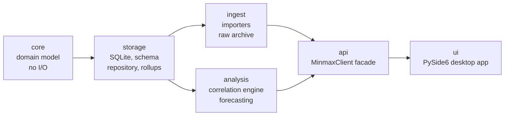

# Minmax — Architecture

This document is the overview of Minmax's code structure: the layers, what lives
in each, the rules about which layer may call which, and how that structure gets
us to the goals in `AGENTS.md` without a rewrite along the way.

It is written to be read by someone picking the project up cold. Where a
decision could reasonably have gone another way, the rationale and the condition
that should make us revisit it are both recorded — see [Key decisions](#key-decisions).

---

## 1. What Minmax is

Minmax is a personal data hub. It imports time-bound data about one person's
life from many sources, stores it durably, lets that person look at it, and —
eventually — tells them which things in their life move together.

Two properties follow from that and drive everything below:

- **The data is precious and largely irreplaceable.** A lost month of
  timetracking cannot be reconstructed. Storage must be transactional, imports
  must be idempotent, and raw source files must be kept.
- **The number of data streams grows without bound, but the *shapes* do not.**
  Timetracking, focused-app history, sleep, heart rate, and commits are five
  sources but only three shapes. Modelling the shapes rather than the sources is
  what keeps the correlation engine from needing a special case per stream.

## 2. Design principles

These are the invariants from `AGENTS.md`, restated as things the code must
structurally enforce rather than merely intend.

1. **The UI cannot reach into the backend.** Not "should not" — *cannot*. The UI
   depends on a single narrow interface (`MinmaxClient`) and never imports a
   storage or analysis module. See [§8](#8-the-ui-boundary).
2. **Dependencies point one direction.** `core → storage → ingest/analysis → api → ui`.
   A module never imports from a layer to its right. This is what makes each
   layer testable alone.
3. **Every write is a transaction.** No partially-applied import is ever visible.
4. **Every import is idempotent and reversible.** Re-importing the same file
   changes nothing; every stored row knows which import produced it, so an
   import can be undone.
5. **Raw sources are immutable.** Imported files are archived byte-for-byte
   before parsing. If the parser was wrong, the fix is to re-import, never to
   hand-edit the database.
6. **Analysis reads aggregates, not raw rows,** wherever it can. This is the
   single decision that keeps the correlation engine fast as streams grow.

## 3. Layer map



Arrows point from a dependency to its dependent: `core` knows about nobody,
`ui` knows only about `api`.

## 4. The domain model

### 4.1 Three stream kinds

Every datastream Minmax will ever ingest reduces to one of three shapes. This is
the central abstraction of the project.

| Kind | Shape | Examples | Rows/year (typical) |
|---|---|---|---|
| **Interval** | something was true from `start` to `end` | timetracking, focused app, sleep phases | 10⁵–10⁶ |
| **Event** | something happened at an instant | git commits, purchases, doses taken | 10³–10⁵ |
| **Sample** | a number had a value at an instant | heart rate, weight, CPU load | 10⁶–10⁸ |

Timetracking — the first stream we implement — is an interval stream. Nothing
about the import, storage, or query path is Timecard-specific; a focused-app
importer written later reuses all of it and differs only in its parser.

Sample streams are the only kind with a scale problem, and they are the reason
rollups ([§7](#7-rollups)) exist.

### 4.2 Categories are hierarchical paths

Interval and event streams label each record with a **category**: `media/gaming/chess`,
`school/exam/CSE 351`. The path is stored whole; the hierarchy is *derived* from
it rather than stored as a parent-pointer tree.

This mirrors Timecard's own design, and earns the same benefits: no migration
when a level is added, no empty-folder edge cases, and roll-up by prefix
(`media/*`) is a string operation. The cost is that renaming a branch re-paths
its descendants — acceptable, and rare.

Categories carry a **stable source id** where the source provides one. Timecard's
`timer_id` survives renames and folder moves, so runs of one timer stay grouped
even though the `timer_name` recorded on each run is only the path *at the moment
it was recorded*. Minmax preserves both: the source id identifies the category,
the recorded path is kept on the record for historical fidelity.

### 4.3 Time is stored twice, deliberately

Every timestamp is persisted as **epoch seconds UTC** *and* the **UTC offset in
effect at that instant**.

UTC alone is not sufficient for a life tracker. Almost every question the user
will ask — "how much did I sleep Tuesday", "what do my mornings look like" — is a
question about *local wall-clock time*. Across a DST boundary or a flight, UTC
silently reassigns records to the wrong local day. Storing the offset alongside
makes the original local time exactly recoverable, and makes "which local day was
this?" a stored fact rather than a guess.

Local date and hour are therefore computed **once at import** and stored, not
recomputed per query.

## 5. Module map

```
src/minmax/
├── core/            # Domain model. Pure. No I/O, no SQL, no framework imports.
│   ├── models.py    #   Stream, Category, IntervalRecord, StreamKind, ImportRun
│   ├── timeref.py   #   Instant, local-period bucketing, offset-aware conversions
│   ├── timeline.py  #   Day-timeline layout arithmetic (§8) — no Qt
│   ├── trends.py    #   Stacked-area layout arithmetic (§8) — no Qt
│   ├── palette.py   #   Validated categorical palette and slot assignment
│   └── paths.py     #   Category path parsing, prefix matching, tree derivation
│
├── storage/         # Persistence. The only layer that knows SQL exists.
│   ├── migrations/  #   NNNN_name.sql, applied in order; the schema's history
│   ├── database.py  #   Connection setup, PRAGMAs, migration runner
│   ├── repository.py#   The read/write API. Callers use this, never raw SQL.
│   └── rollups.py   #   Aggregate maintenance (§7)
│
├── ingest/          # Getting foreign data in. One module per source.
│   ├── base.py      #   Importer protocol, ParseResult, the import pipeline
│   ├── archive.py   #   Byte-for-byte raw file archiving + content hashing
│   └── timecard.py  #   Timecard CSV → IntervalRecord
│
├── analysis/        # Statistics over stored data. Reads; never writes history.
│                    #   (correlation engine, then forecasting — see §9)  [not yet built]
│
├── api/             # The facade the UI talks to.
│   ├── client.py    #   MinmaxClient protocol + InProcessClient + transfer objects
│   └── format.py    #   Formatting every client must render identically
│
├── ui/              # PySide6 desktop app. Imports `api` and nothing else.
│   ├── app.py       #   Event loop entry point
│   ├── main_window.py#  Window, navigation, the keyboard shortcut table
│   ├── timeline_view.py# Day timeline: paint and input only
│   ├── summary_panel.py# Category totals for the shown day
│   ├── trends_view.py# Stacked area over days: paint and input only
│   ├── trends_legend.py# Per-group share of the visible days
│   └── theme.py     #   Colours derived from the system palette (light/dark)
│
└── cli.py           # Command-line entry point. A thin shell over the layers
                     # above, and how the data is reachable without a GUI.
```

Each layer's hard rule:

- **`core`** may not import anything from Minmax outside `core`, and may not
  perform I/O. Everything here is deterministic and trivially unit-testable.
- **`storage`** is the sole owner of SQL. If a string containing `SELECT` appears
  outside `storage/`, that is a bug.
- **`ingest`** parses and validates; it does not decide storage layout. An
  importer's job is to turn a foreign file into validated `core` objects and hand
  them to the repository in one transaction.
- **`analysis`** is read-only with respect to user data. It may write to caches
  and derived tables, never to the record of what happened.
- **`api`** contains no business logic — it composes the layers below into the
  operations a UI actually needs, and is the *only* thing the UI may import.
- **`ui`** contains no logic worth testing headlessly. If something in `ui` needs
  a unit test, it belongs one layer down.

## 6. Storage

**SQLite**, one file, as the store of record.

The schema is organised around the three stream kinds:

- `stream` — one row per datastream (`timecard`, `focused_app`), carrying its
  kind and whether it is *exclusive* (at most one observation true at a time).
- `category` — categories within a stream, keyed by stable source id, holding the
  current path.
- `interval_record` — interval observations, indexed on `(stream_id, started_at)`.
  The `event_record` and `sample_record` tables follow the same pattern and are
  added by a migration when the first such stream lands; creating them empty now
  would only mean untested, unused schema.
- `import_run` — provenance: which file (by SHA-256), when, how many rows
  inserted/skipped. Every observation row carries its `import_run_id`, which is
  what makes an import reversible.
- `rollup` — derived aggregates, keyed by `(stream, category, period, bucket)`
  where `period` is `hour` or `day` ([§7](#7-rollups)).

Migrations live in `storage/migrations/` as numbered SQL files and are tracked
by SQLite's own `user_version`, so a fresh database needs no bootstrapping and
each migration applies atomically or not at all.

**Idempotency** is enforced by the database, not by the importer: a uniqueness
constraint on each observation's natural key (`stream_id`, `category_id`,
`started_at`, `ended_at`) means a re-import inserts nothing. The importer reports
what was skipped rather than discovering duplicates itself.

**Everything goes through `repository.py`.** That indirection is not ceremony —
it is the seam that lets the analytics engine change later ([§10](#key-decisions))
without touching a single caller.

## 7. Rollups

The correlation engine will ask questions like "minutes of `media/*` per day" and
"mean heart rate per hour." Answering those from raw rows means scanning
everything, every time; answering them from precomputed aggregates is a
bounded-size lookup.

So aggregates are a first-class stored table, refreshed transactionally as part
of each import:

```
rollup(stream_id, category_id, period, bucket, seconds, record_count)
```

`period` is `hour` or `day`; `bucket` is `YYYY-MM-DDTHH` or `YYYY-MM-DD`. Those
key formats sort lexicographically in chronological order, so a range query over
rollups is a plain string comparison.

Bucketing is by **local** hour/day, per [§4.3](#43-time-is-stored-twice-deliberately),
and an observation crossing a bucket boundary is *split* across the buckets it
touches while remaining one row — 29 of the 338 runs in the first Timecard
export cross local midnight, so without splitting, daily totals would be badly
wrong. `record_count` counts observations touching a bucket, which makes it
meaningful within a bucket but not summable across them.

Three years across twenty streams is on the order of 10⁵ rollup rows — small
enough to scan exhaustively no matter how large the raw tables get. This is why
SQLite remains appropriate even once sample streams arrive: analysis rarely
touches the expensive tables.

Maintenance has two paths on purpose. `apply_intervals` folds newly inserted
rows in incrementally, at a cost proportional to the insert rather than the table
size. `rebuild` recomputes from the observation tables, and is both the repair
path after a revert and the oracle the incremental path is tested against — a
test asserts the two agree, so aggregate drift cannot go unnoticed.

## 8. The UI boundary

`AGENTS.md` requires that redoing the UI have no effect on the underlying
systems. That is enforced by construction:

```
ui  ──▶  MinmaxClient (protocol)  ──▶  { InProcessClient | HttpClient }
```

The UI is written against the `MinmaxClient` **protocol** only. Today the desktop
app binds it to `InProcessClient`, which calls the repository and analysis layers
directly — no server process, no serialization cost. When the web UI arrives, an
`HttpClient` implementation and a thin server that exposes the same operations get
added; neither the existing UI nor any backend module changes.

The protocol is therefore designed as though it were already a network API:
coarse-grained operations, serializable arguments and return values, no leaking
of live database objects across it. A test walks `ui/` and fails if any module
there mentions `storage`, `ingest`, or `analysis`, so the boundary is checked
mechanically rather than by discipline.

**Anything the UI would otherwise have to compute lives below it.** Three kinds
of thing get pushed down, each for the same reason — a second client must not be
able to disagree with the first, and logic hidden in a paint method is untested
logic:

- *Layout arithmetic* → `core/timeline.py`. Block positions, label thresholds,
  and the scroll offset that keeps zoom anchored under the pointer. Free of Qt,
  and unit-tested directly.
- *Timezone-dependent labels* → `api`. Turning an hour boundary into a clock
  reading needs a timezone, so `DayView` carries labelled `hour_marks`. A view
  deriving labels from elapsed time would count to `24:00` on a fall-back day
  when the clock actually read `01:00` twice.
- *Colours* → `core/palette.py` plus the `group_color` table. Timecard gives
  colour to a top-level folder so a whole branch reads as one colour, and Minmax
  keeps that model. Colours are *assigned from the palette and stored*, not
  hashed from the name: hashing is stable but collides, and a sorted index would
  shift a group's colour the moment another group appeared. What is stored is a
  palette **slot**, not a hex value, so each slot carries its own step for light
  and dark surfaces and the palette can be re-stepped without a migration.

### 8.1 Chart rules

The trends chart follows a fixed set of rules rather than taste, because a chart
is read by people and a plausible-looking wrong one is worse than none:

- **At most eight categorical hues**, in a fixed assignment order, never cycled.
  Past eight, adjacent hues stop being distinguishable under colour-vision
  deficiency, so the tail folds into a neutral `Other` — which is not given a hue,
  because it is not an identity.
- **Colour follows the entity, never its rank.** The series set and its colours
  are decided over the whole range, not the visible window, so scrolling never
  repaints anything.
- **The palette is validated, not eyeballed.** The eight steps clear the
  lightness band, chroma floor, CVD separation (worst adjacent ΔE 9.1 light /
  8.4 dark against a target of 8) and the normal-vision floor (19.6 / 19.3
  against 15) on both surfaces. Three light steps fall below 3:1 contrast, which
  obliges visible labels — the legend supplies them.
- **A legend is always present**, so identity is never carried by colour alone,
  and no value is printed on every point: the axis and the hover tooltip carry
  detail.
- **Solid hairline gridlines**, never dashed (dashing reads as a threshold), and
  a 2px surface gap between stacked bands rather than borders around them.
- **Empty days are drawn as empty.** Days with no data keep their column, and in
  percentage mode they stay at zero rather than being stretched to fill — an
  untracked day has no composition to show.

## 9. Roadmap → structure

How each goal in `AGENTS.md` lands in the structure above.

| Goal | Where it lives | Needs new structure? |
|---|---|---|
| Import/store/retrieve timetracking ✅ | `ingest/timecard.py`, `storage/` | — |
| UI for timetracking ✅ | `ui/`, `api/client.py` | — |
| Trends over time ✅ | `ui/trends_view.py`, `core/trends.py` | reads `rollup` (day) |
| Correlation engine + recommendations | `analysis/` | reads `rollup_daily` |
| Streams beyond timetracking | one new module in `ingest/` each | — |
| Multi-stream timeline | `ui/`, one new `api` query | — |
| Cross-stream correlation | `analysis/` | — |
| "Increase X" → advice queries | `analysis/` | ranks existing correlations |
| DL forecasting model | `analysis/` submodule | training data comes from rollups |

Every later goal is additive. Nothing above requires the storage schema or the
layer boundaries to change — which was the point of settling them now.

## 10. Testing strategy

Per the invariants, tests exist to protect the data and the experience:

- **`core`** — pure unit tests. Path parsing, DST-boundary local-day bucketing,
  time range arithmetic.
- **`storage`** — round-trip tests against a temp-file database, plus explicit
  tests that constraints *reject* bad data (overlapping intervals, duplicate
  natural keys, orphaned categories).
- **`ingest`** — golden-file tests against a real Timecard export, malformed-input
  tests (bad timestamps, unclosed quotes, negative durations), and an
  **idempotency test**: importing twice must leave the database byte-identical.
- **`analysis`** — statistical results checked against hand-computed fixtures.
- **`api`** — the facade tested through its protocol, which doubles as the
  contract the future `HttpClient` must satisfy.

Time is injected, never read from the system clock inside logic, so every
time-dependent rule is deterministic.

---

## Key decisions

Recorded with rationale and the condition that should trigger a revisit.
All four were reviewed with the user on 2026-08-05.

### D1 — Python

The endpoint goals are a correlation engine and a custom DL model; that work
lives in Python's ecosystem (polars, scipy, statsmodels, PyTorch). Type hints
plus a type checker give enough static safety for a data-integrity-critical
codebase.

*Rejected:* TypeScript (would need a Python service for analysis anyway,
splitting the codebase); Rust (slow to reach the analysis goals, and single-user
data volumes never need its speed); Swift (matches Timecard, but has no analysis
or DL ecosystem).

*Revisit if:* an import path becomes CPU-bound in a way vectorization can't fix.

### D2 — SQLite as store of record

Single file, ACID, zero operational burden, backed up by copying one file. Holds
up well past the scale a personal hub reaches: ~100M narrow rows is 5–10 GB with
indexed time-range reads still fast.

The known weakness is full-table analytical scans over sample streams, since a
row store reads every column. That is mitigated structurally by rollups
([§7](#7-rollups)), which keep analysis off the raw tables entirely.

*Rejected:* DuckDB as primary (weaker as a concurrently-written store of record);
Parquet/flat files (no transactions or constraints — directly conflicts with the
data-safety invariant); PostgreSQL/TimescaleDB (a server to run and back up for
one user, with no payoff at this size).

*Revisit if:* a single stream passes ~50M raw rows **and** a query can't be
served by a rollup. The escape hatch is additive, not a rewrite — DuckDB reads
SQLite files and Parquet directly, so it can be attached as a read-only analytics
engine behind `repository.py`, and cold sample data can age out to Parquet on the
same path.

### D3 — PySide6/Qt native desktop UI

Keyboard-first interaction is a priority, and Qt's `QAction`/`QShortcut` model
gives fully remappable, discoverable shortcuts. Keeps the project to one
language, and Qt's painting is well suited to the zoomable timeline goal.

*Rejected:* SwiftUI (truly native and consistent with Timecard, but a second
toolchain and a forced HTTP boundary from day one); Textual (excellent
keyboard story, weakest fit for the dense timeline).

*As built:* the day timeline is a custom-painted `QWidget` inside a
`QScrollArea` rather than a `QGraphicsView`. One day is a single column of
non-overlapping blocks, which needs neither a scene graph nor item picking, and
direct painting keeps the widget to paint-and-input with all arithmetic in
`core/timeline.py`. `QGraphicsView` remains the natural choice for the
multi-stream timeline, where many lanes and per-item interaction do earn a
scene.

*Revisit if:* the multi-stream timeline arrives, or a day's rendering stops
being smooth at maximum zoom.

### D4 — Facade now, HTTP later

The UI binds to the `MinmaxClient` protocol; the native app uses the in-process
implementation. A web UI later adds an `HttpClient` and a server behind the same
protocol.

*Rejected:* HTTP from day one (a server process and serialization cost for a
separation the protocol already guarantees); direct in-process calls (nothing
would structurally stop UI code from depending on backend internals — the one
invariant `AGENTS.md` is most explicit about).

*Revisit if:* a second client appears — at that point the `HttpClient` gets
written, which is the planned path rather than a change of course.
